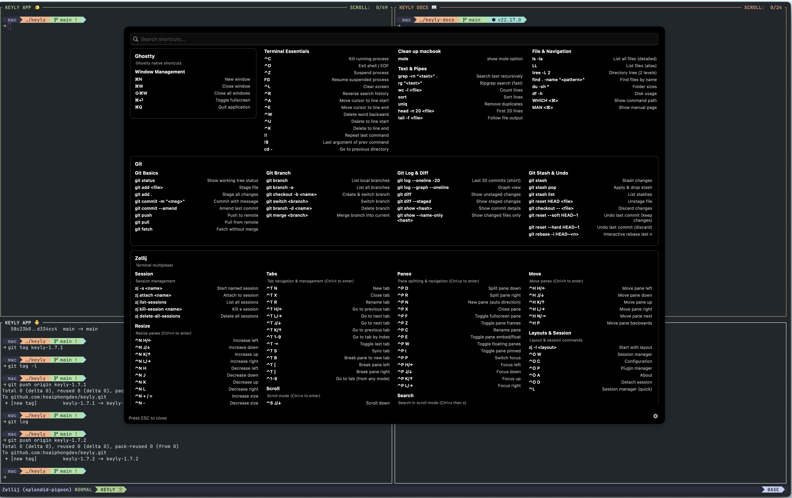

# Keyly

macOS menu bar app that displays keyboard shortcuts for the currently active application when you double-tap the ⇪ Caps Lock key.

## 🚀 Installation

> **1.** Open any terminal app on your Mac (Terminal, iTerm, Warp, etc.)
>
> **2.** Paste this command and press Enter:

```bash
curl -fsSL https://raw.githubusercontent.com/hoaiphongdev/keyly/main/scripts/install.sh | bash
```

> **3.** Follow the on-screen instructions to grant Accessibility permission
>
> **4.** Done! Double-tap `⇪ Caps Lock` to show shortcuts

## Screenshots

<p align="center">
  
  <br><br>
  
</p>

## Features

- **Customizable Trigger**: Double-tap ⇪ Caps Lock (default), or hold/press any key combination
- **Real-time Search**: Search shortcuts with instant filtering
- **Group System**: Organize shortcuts into groups with descriptions
- **Custom Templates**: Create `.keyly` files for any application
- **Runtime Settings**: Configure via `~/.config/keyly/setting.conf`
- **Multiple Close Options**: Press ESC or click outside to close
- **Dynamic UI**: Responsive layout that adapts to content
- **Global Shortcuts**: System-wide shortcuts from templates

## Requirements

- macOS 12.0+
- Swift 5.9+
- Accessibility permissions

## Permissions

The app requires Accessibility permissions to:
1. Monitor global keyboard events
2. Read menu bar shortcuts from other applications

On first launch, go to **System Settings → Privacy & Security → Accessibility** and enable **Keyly**.

## Usage

1. Run the app - you'll see a **K** icon in the menu bar
2. Open any application
3. Double-tap the **Caps Lock (⇪)** key (default)
4. A window will appear showing all keyboard shortcuts
5. **Start typing** to search; the first **ESC** clears the search
6. **Close the window by**:
   - Press **ESC** key
   - **Click outside** the window

## Configuration

### Settings (`~/.config/keyly/setting.conf`)

Configure app behavior:

```ini
# Super key configuration
super_key=capslock
trigger_type=press
press_count=2

# UI settings
screen_width_ratio=0.7
```

**Options:**
- `super_key`: `capslock` (default) or key combination (e.g., `cmd`, `cmd+shift`, `ctrl+alt`); unknown key names fall back to the default
- `trigger_type`: `hold` or `press` (`capslock` always uses `press`)
- `hold_duration`: Hold time in seconds (for `hold`)
- `press_count`: Number of taps (for `press`)
- `screen_width_ratio`: Window width ratio (0.1-1.0)

### Custom Templates (`~/.config/keyly/templates/`)

Create `.keyly` files for any application:

```
# Sheet Name: My Shortcuts
# App: /Applications/Safari.app
# Hide Default: false

# Group: Navigation - Web browsing shortcuts

[Tabs]
⌘T | New tab
⌘W | Close tab
⇧⌘T | Reopen last tab

[Bookmarks]
> Bookmark management
⌘D | Add bookmark
⌘L | Open location

# Group: Tools - CLI shortcuts

[Session]
tool start | Start new session
tool attach <name> | Attach to session
```

**Syntax:** each line is `shortcut  description`, in one of two forms:

- `⇧⌘T | Reopen last tab` — split on `|`; use this when the left side contains spaces
- `CMD+SHIFT+T    Reopen last tab` — split on the first tab or run of 2+ spaces (or the first space)

Written modifiers are converted to symbols: `CMD`/`COMMAND` → ⌘, `CTRL`/`CONTROL` → ⌃, `OPT`/`OPTION`/`ALT` → ⌥, `SHIFT` → ⇧, plus named keys such as `ENTER`, `TAB`, `ESC`, `SPACE`, `DELETE` and arrows. Files placed directly in `~/.config/keyly/` are loaded too.

**Template Features:**
- `# Hide Default: true` — Hide system menu shortcuts
- `# Group: Name - Description` — Group shortcuts with optional description
- `[Category]` — Category header
- `> Description` — Category description
- `global.keyly` — shortcuts shown for every app
- Lines without a shortcut and a description are ignored

## Community Templates

Install pre-made shortcut templates from the community:

Install a template:

```bash
curl -sL https://raw.githubusercontent.com/hoaiphongdev/keyly/main/scripts/install-templates.sh | bash -s -- -t cursor.keyly
```

Install with custom name:

```bash
curl -sL https://raw.githubusercontent.com/hoaiphongdev/keyly/main/scripts/install-templates.sh | bash -s -- -t cursor.keyly -n my-cursor.keyly
```

**Options:**
- `-t <name>` - Template name (required)
- `-n <name>` - Save as custom filename (optional)

**Available templates:** [templates/](https://github.com/hoaiphongdev/keyly/tree/main/templates)

## Auto-Update

Keyly uses [Sparkle](https://sparkle-project.org/) for automatic updates. It checks for a new release every 6 hours. When one is available, the menu bar icon gets a red dot, a **"Update to x.y.z…"** menu item appears and you get a notification. You can also check manually via:
- Menu bar icon → Check for Updates...
- Settings button → Check for Updates...

Updates keep your Accessibility permission: every release is signed with the same certificate.

> **Upgrading from 1.7.3 or older?** Those versions have no updater. Run the install command above once more, then grant Accessibility again (the signing changed). After that, updates arrive automatically.

### For Developers: Release Process

1. **One-time setup**: create the signing certificate and Sparkle EdDSA keys, then add the GitHub secrets the scripts print (`KEYLY_CERT_P12_BASE64`, `KEYLY_CERT_PASSWORD`, `SPARKLE_PRIVATE_KEY`):
   ```bash
   just setup-signing
   ```
   Back up `~/.keyly-signing`. Replacing the certificate resets every user's Accessibility permission, and losing the EdDSA key means installed copies can no longer verify updates. Never change both in the same release.

2. **Release**: add a `## [x.y.z]` section to `CHANGELOG.md`, commit, then:
   ```bash
   just release 1.8.0
   ```
   This pushes the tag `keyly-1.8.0`. GitHub Actions builds and signs `Keyly.dmg`, generates `appcast.xml`, and publishes both to the release. Tags with a suffix (`keyly-1.8.0-rc1`) become prereleases that the app ignores.

## License

Licensed under the [MIT License](LICENSE).

---

Made with ❤️ by [hoaiphongdev](https://github.com/hoaiphongdev)
