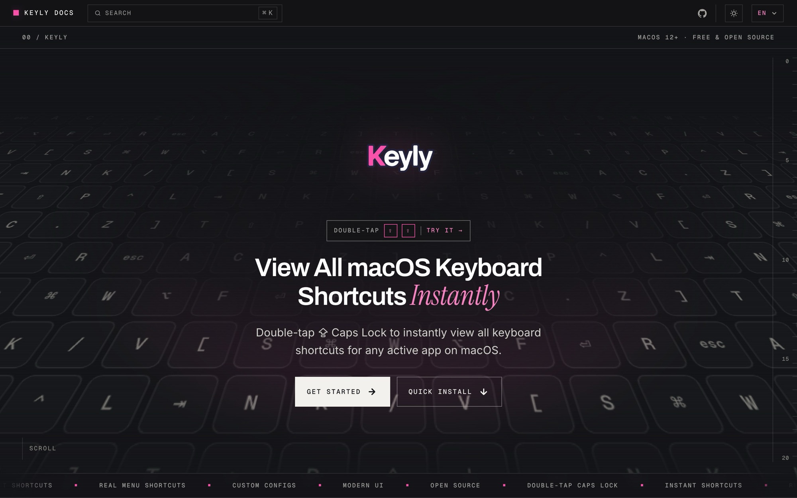
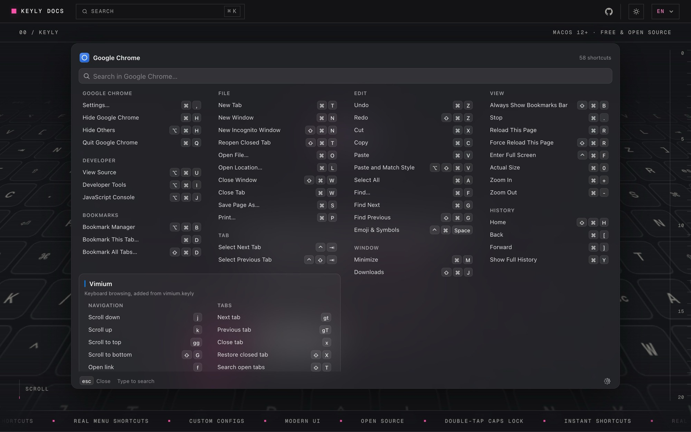
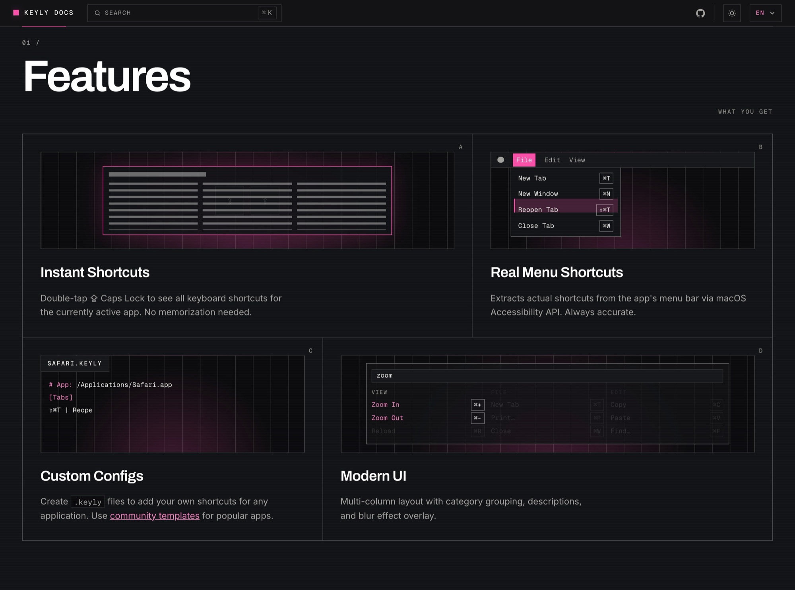
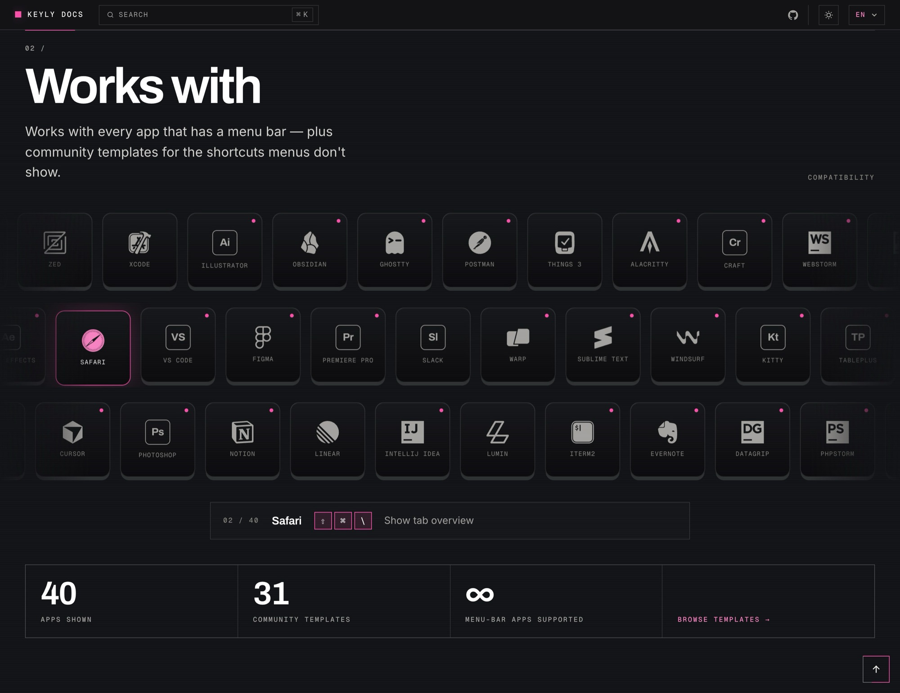

<p align="center">
  
</p>

<h3 align="center">Every shortcut of the app in front of you, one double-tap away.</h3>

<p align="center">
  Double-tap <kbd>⇪ Caps Lock</kbd> and Keyly shows all keyboard shortcuts of the active macOS app.<br>
  Free, open source, lives in your menu bar.
</p>

<p align="center">
  <a href="https://github.com/hoaiphongdev/keyly/releases/latest"></a>
  
  
  <a href="LICENSE"></a>
</p>

<p align="center">
  <a href="https://keyly-docs.com"><b>Docs</b></a> ·
  <a href="#install"><b>Install</b></a> ·
  <a href="#custom-shortcuts"><b>Custom shortcuts</b></a> ·
  <a href="templates"><b>Templates</b></a> ·
  <a href="CHANGELOG.md"><b>Changelog</b></a>
</p>

<p align="center">
  
</p>

---

## Install

Open any terminal (Terminal, iTerm, Warp…) and run:

```bash
curl -fsSL https://raw.githubusercontent.com/hoaiphongdev/keyly/main/scripts/install.sh | bash
```

Then grant **Accessibility** permission when prompted (**System Settings → Privacy & Security → Accessibility → Keyly**). That's it — double-tap <kbd>⇪ Caps Lock</kbd>.

> [!NOTE]
> Keyly needs Accessibility access to watch for the double-tap and to read the menu bar shortcuts of other apps. It reads nothing else.

## How it works

<p align="center">
  
</p>

| You want to…              | Do this                                    |
| ------------------------- | ------------------------------------------ |
| See the shortcuts         | Double-tap <kbd>⇪ Caps Lock</kbd>          |
| Find one                  | Just start typing                          |
| Clear the search          | <kbd>esc</kbd>                             |
| Close the window          | <kbd>esc</kbd> again, or click outside     |
| Reload, open config, update | <kbd>⚙︎</kbd> in the window's bottom-right corner |

The **K** icon in the menu bar has **About Keyly**, **Check for Updates...** and **Quit**.

## Features

<p align="center">
  
</p>

- **Real menu shortcuts** — read live from the app's menu bar through the macOS Accessibility API, so they're always the ones the app actually uses.
- **Instant search** — type to filter by action, menu or key; matches are highlighted.
- **Custom shortcuts** — add anything menus don't show with plain-text `.keyly` files.
- **Community templates** — ready-made sheets for 31 popular apps, one command to install.
- **Groups & global shortcuts** — organise sheets into groups, and keep system-wide shortcuts in `global.keyly`.
- **Fits any screen** — a multi-column layout that sizes itself to your display, even on a 13" MacBook.
- **Your trigger** — Caps Lock by default, or any key combination you like, held or tapped.
- **Auto-update** — signed updates through Sparkle; your Accessibility permission survives them.

## Works with

<p align="center">
  
</p>

Keyly works with **every app that has a menu bar**. Some apps keep most shortcuts out of their menus (editors, design tools, terminals); for those, [community templates](templates) fill the gaps:

> Adobe Acrobat · After Effects · Animate · Illustrator · Lightroom Classic · Photoshop · Premiere Pro · Alacritty · Craft · Cursor · DataGrip · Evernote · Figma · Ghostty · IntelliJ IDEA · iTerm2 · Kitty · Notion · Obsidian · PhpStorm · Postman · PyCharm · Rider · RubyMine · RustRover · Sublime Text · TablePlus · VS Code · Warp · WebStorm · Windsurf

```bash
# Install a template (saved to ~/.config/keyly/templates/)
curl -sL https://raw.githubusercontent.com/hoaiphongdev/keyly/main/scripts/install-templates.sh | bash -s -- -t cursor.keyly
```

| Option      | Meaning                                    |
| ----------- | ------------------------------------------ |
| `-t <name>` | Template to install (`.keyly` is optional) |
| `-n <name>` | Save it under another file name            |
| `-f`        | Replace the file if it already exists      |

## Custom shortcuts

Drop `.keyly` files in `~/.config/keyly/templates/` (files directly in `~/.config/keyly/` load too). Changes apply as soon as you save.

```keyly
# Sheet Name: Safari Extras
# App: /Applications/Safari.app

# Group: Browsing - Everyday navigation

[Tabs]
> Tab management
⇧⌘T | Reopen last tab
CMD+L       Open location

[Tools]
open -a Safari . | Open the current folder in Safari
```

Each shortcut line is a key combination and a description, written either way:

- `⇧⌘T | Reopen last tab` — split on `|`; use it when the left side has spaces
- `CMD+SHIFT+T    Reopen last tab` — split on a tab or two or more spaces

Written modifiers become symbols — `CMD`/`COMMAND` → ⌘, `CTRL`/`CONTROL` → ⌃, `OPT`/`OPTION`/`ALT` → ⌥, `SHIFT` → ⇧ — as do named keys like `ENTER`, `TAB`, `ESC`, `SPACE`, `DELETE` and the arrows.

| Directive                     | What it does                                                 |
| ----------------------------- | ------------------------------------------------------------ |
| `# App: /path/to/App.app`     | **Required.** The app this sheet belongs to                  |
| `# Sheet Name: …`             | Optional label for the file                                  |
| `# Hide Default: true`        | Show only your shortcuts, not the app's menu shortcuts       |
| `# Group: Name - Description` | Put the following categories in a card (`# Group: none` ends it) |
| `[Category]`                  | Start a category                                             |
| `> Description`               | Subtitle for the current category                            |

Shortcuts in `templates/global.keyly` appear for **every** app — the place for system shortcuts like ⌘Tab that no menu lists.

## Settings

`~/.config/keyly/setting.conf`

```ini
super_key=capslock
trigger_type=press
press_count=2
screen_width_ratio=0.7
```

| Key                  | Values                                                                                     |
| -------------------- | ------------------------------------------------------------------------------------------ |
| `super_key`          | `capslock` (default) or a combination such as `cmd`, `cmd+shift`, `ctrl+alt`. Unknown names fall back to the default |
| `trigger_type`       | `press` or `hold` (`capslock` always uses `press`)                                         |
| `press_count`        | Taps needed for `press` (default `2`, within half a second)                                |
| `hold_duration`      | Seconds to hold for `hold`                                                                 |
| `screen_width_ratio` | Maximum window width as a share of the screen (`0.1`–`1.0`, default `0.7`)                 |

## Updates

Keyly checks for a new version every 6 hours. When one is out, the menu bar icon gets a red dot and an **Update to x.y.z…** item; you can also use **Check for Updates...** at any time. Every release is signed with the same certificate, so the Accessibility permission stays granted.

> [!IMPORTANT]
> **Coming from 1.7.3 or older?** Those builds have no updater. Run the install command once more and grant Accessibility again; updates are automatic from then on.

## Development

Requires macOS 12+, Swift 5.9 and [`just`](https://github.com/casey/just).

```bash
just build     # debug build
just dev       # run with KEYLY_DEV=1: shows the window without keyboard monitoring
just prod      # release build and run
```

<details>
<summary><b>Release process</b></summary>

1. **One-time setup** — create the signing certificate and Sparkle EdDSA keys, then add the GitHub secrets the scripts print (`KEYLY_CERT_P12_BASE64`, `KEYLY_CERT_PASSWORD`, `SPARKLE_PRIVATE_KEY`):

   ```bash
   just setup-signing
   ```

   Back up `~/.keyly-signing`. Replacing the certificate resets every user's Accessibility permission, and losing the EdDSA key means installed copies can no longer verify updates. Never change both in the same release.

2. **Release** — add a `## [x.y.z]` section to `CHANGELOG.md`, commit, then:

   ```bash
   just release 1.9.0
   ```

   This pushes the tag `keyly-1.9.0`. GitHub Actions builds and signs `Keyly.dmg`, generates `appcast.xml` and publishes both to the release. Tags with a suffix (`keyly-1.9.0-rc1`) become prereleases that the app ignores.

</details>

## License

[MIT](LICENSE) · Made with ❤️ by [hoaiphongdev](https://github.com/hoaiphongdev)
